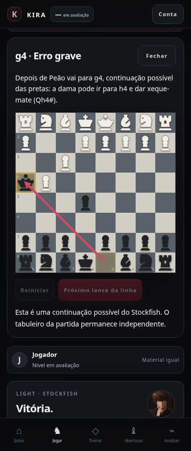

# Avaliação ao vivo: bot e tabuleiro físico

Em **Jogar**, escolha **Jogar contra o bot** ou **Tabuleiro físico**. Selecione **Meu lado**, toque em **Nova** para aplicar a cor e ative **Avaliação ao vivo**. A opção também pode ser ativada numa partida em andamento, avaliando os lances já registrados.

No tabuleiro físico, registre manualmente os lances legais dos dois lados por toque ou arraste, na mesma ordem do tabuleiro real. O lado selecionado identifica suas decisões no diagnóstico; o aplicativo não joga pelo adversário. Não há reconhecimento por câmera nesta entrega.

## Como funciona

- Os dois modos compartilham a mesma instância do Stockfish local, a mesma fila e a mesma profundidade de análise (11).
- Cada lance fica **Calculando…** e recebe sua classificação quando a comparação termina. O tabuleiro e o bot continuam funcionando durante o carregamento/cálculo. A etiqueta pertence ao lance que foi calculado, mesmo se a posição já avançou.
- As classes são Melhor lance, Bom lance, Imprecisão, Erro e Erro grave, com os mesmos critérios usados no diagnóstico por fase.
- Ao tocar numa etiqueta pronta, um tabuleiro de explicação mostra a resposta possível do adversário com seta, origem/destino e descrição em português, com notação ao lado. É possível avançar pela linha calculada. Esse tabuleiro não altera a partida.
- Se o lance encerrou a posição, a explicação informa mate/empate. Se não há linha suficiente, informa a limitação em vez de inventar uma resposta.
- Falha do motor não impede jogar; os lances continuam registrados e há uma opção para tentar novamente.
- **Encerrar registro** permite salvar uma partida antes de uma posição terminal, com resultado informado pelo usuário ou PGN `*` quando não informado. Mate/empate pelas regras continuam encerrando automaticamente.

## Persistência e diagnóstico

A partida concluída salva PGN, lances, avaliações dos dois lados, profundidade e continuação. O diagnóstico de abertura/desenvolvimento, meio-jogo e final usa apenas as decisões do lado selecionado. Os resultados já calculados são reutilizados; avaliações que terminam depois do encerramento atualizam o histórico.

Após recarregar, avaliações pendentes do registro concluído são retomadas. O registro em andamento também é restaurado. Troca de conta ou descarte de uma partida não aplica resultados antigos a outra partida/perfil. O tabuleiro físico entra na amostra humana junto dos PGNs, sem receber Elo de bot.

A sincronização entre contas continua dependendo da configuração externa do Supabase descrita em `google-sincronizacao.md`. Os testes desta entrega são como convidado.

## Validação

```bash
npm test
npm run dev -- --port 8081
KIRA_TEST_URL=http://127.0.0.1:8081 npm run test:browser
KIRA_TEST_URL=http://127.0.0.1:8081 npm run test:auth
KIRA_TEST_URL=http://127.0.0.1:8081 npm run test:live
npm run build
```

`test:live` executa Chromium com toque, Stockfish real e perfis de convidado separados:

- Bot em largura de desktop: três lances registrados enquanto o download WASM é adiado pelo teste. O bot responde e o jogador continua antes de o motor carregar. Encerramento antes do cálculo terminar, etiquetas, seta e persistência verificados.
- Físico em largura de celular (390 px): ambos os lados registrados por toque, jogador de pretas, mate do louco completo, quatro avaliações, explicação do mate permitido em português, seta, movimento reduzido e persistência no diagnóstico.
- A retenção artificial do download testa uma conexão lenta; as avaliações e as jogadas do bot não são simuladas.
- As suítes anteriores mantêm os testes de fases, treino e sincronização simulada.

Para a prévia privada, `node tests/live-browser.test.js --private-preview` recebe URL e autorização somente por stdin oculto. O Chromium executa os arquivos publicados, obtidos por HTTP autenticado com TLS verificado; nenhum conteúdo do aplicativo nem resultado do Stockfish é substituído. As etapas de jogo e aceite são as mesmas do teste local. O acesso privado do Sites é independente do perfil convidado do Kira. O resultado dessa execução fica registrado no PR.



Os dois modos também foram exercitados como convidado na prévia web publicada, com os mesmos cenários de clique/toque, Stockfish real, retomada e persistência. O resumo final aguarda as avaliações pendentes antes de comentar a qualidade da partida.
