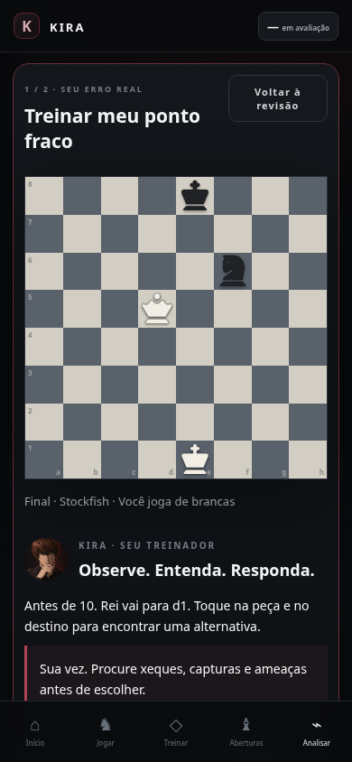
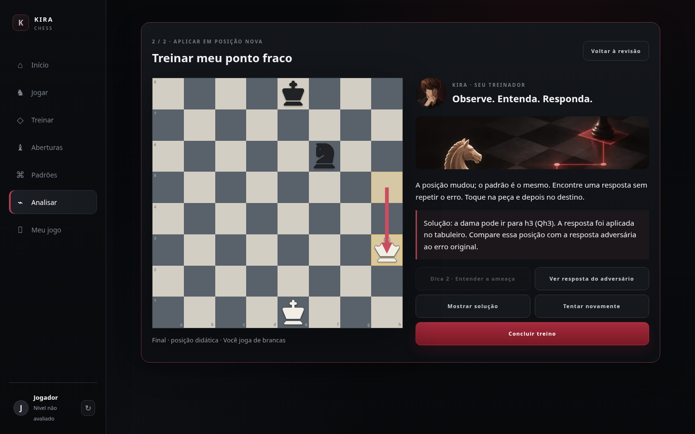

# Validação: partida → diagnóstico → treino

Entrega na branch `codex/diagnostico-por-fase`, PR #1.

## Verificado em Chromium com Playwright

- Importação de brancas: mate do louco; 2 decisões verificadas pelo Stockfish local.
- Importação de pretas: mate do pastor; 3 decisões verificadas e tabuleiro orientado para as pretas.
- Partida sintética desde a posição inicial até o final: 25 decisões de brancas, distribuídas em 12 de abertura/desenvolvimento, 9 de meio-jogo e 4 de final. O PGN termina em uma posição de final e não pretende representar uma partida humana completa.
- PGN com posição inicial FEN no final: 2 decisões verificadas.
- PGN com dama atacada: 1 erro verificado, seguido de outra posição do mesmo padrão.
- O botão de exemplo abre o índice correto na revisão e destaca o destino do lance. Diagnóstico e sessão de treino sobrevivem ao recarregamento.
- Treino: primeira dica destaca uma casa; segunda descreve a captura em português com SAN; resposta adversária aplica a continuação, desenha seta e pulsa origem/destino; toque na alternativa resolve; solução aparece no tabuleiro; posição inédita e conclusão funcionam.
- Layout sem rolagem horizontal em 360, 390, 768 e 1440 px. Preferência por movimento reduzido conferida via CSS computado. São larguras emuladas; não houve teste em aparelho Android/iOS físico.
- Finalização pelo tabuleiro: posição de mate preparada no armazenamento de teste, lance final feito por toque na interface; vitória arquivada e diagnóstico do Stockfish acessível pelo botão de fim da partida. Essa preparação não substitui um teste humano de partida inteira contra o bot.
- `npm test`, `npm run test:browser`, `npm run build` e `git diff --check`.

## Correções encontradas no fluxo real

O serviço iniciava o controlador UCI com o sufixo `,worker`, reservado pelo Stockfish.js a workers secundários. A versão local usa o controlador correto e passa o WASM pelo fragmento da URL. A normalização também passou a aceitar partidas salvas na versão 6, que o próprio app já gerava.

## Limites

A análise usa profundidade 11 e uma linha principal: é evidência de treino, não revisão ilimitada. A biblioteca só oferece outra posição quando há correspondência concreta de padrão e novidade. A conclusão continua provisória com poucos dados. Os treinos com estimativa local ficam identificados. O login opcional não foi validado; a chamada do CDN Supabase encontrou erro de certificado no navegador do ambiente, sem impedir o fluxo como convidado.

O relay da prévia temporária do ambiente não ficou pronto. Os testes acima rodaram no servidor local da aplicação; a publicação privada em Sites é um espelho separado, com estado local próprio.

## Capturas

