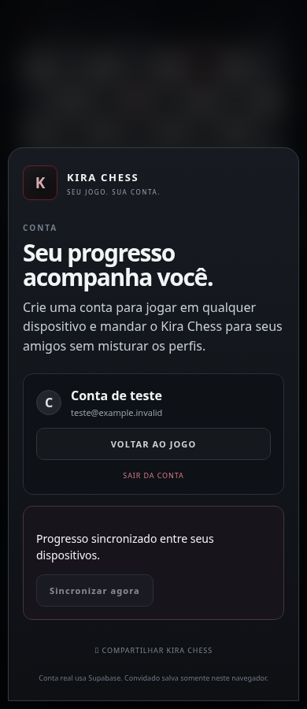

# Google, progresso entre dispositivos e Light

## Estado desta entrega

A branch e o PR #1 foram conferidos antes de editar: base `3318036`, sem mudanças locais. A prévia privada estava publicada na versão 1, com acesso apenas do proprietário; a requisição sem sessão recebeu 401, conforme esperado.

**Google real: ainda não validado.** `js/supabase-config.js` não contém Project URL nem chave pública. Não há acesso configurado a um projeto Supabase, cliente Google nem conta de teste real nesta sessão. Nenhum segredo Google foi solicitado ou gravado no repositório.

**Simulação validada no navegador:** SDK Supabase real incluído localmente, fluxo PKCE com provedor/REST simulados, contextos independentes de PC e celular. O teste importa PGN e usa Stockfish real antes de simular o login.

## Configuração externa exata

1. Abra seu projeto no [Supabase](https://supabase.com/dashboard). Em **Project Settings → API/Data API**, copie a Project URL; em **API Keys**, copie a chave **publishable** ou a antiga **anon**. Preencha apenas esses dois valores públicos em `js/supabase-config.js`. Nunca use `service_role`, `sb_secret_…` ou o segredo Google nesse arquivo.
2. No **SQL Editor**, execute `supabase-setup.sql` completo, inclusive se a tabela já existe. O script pode ser executado novamente: mantém RLS por `auth.uid() = user_id`, acrescenta `revision` e a função `kira_save_profile`. A função usa `security invoker`, valida o dono e recusa gravação sobre uma revisão antiga. Ela só está liberada para o papel `authenticated`.
3. Em **Authentication → URL Configuration**, configure a **Site URL** e adicione em **Redirect URLs**, sem curinga:

   ```text
   https://kira-chess-treino-lalmeida12527.agilesunflower2.chatgpt.site/
   ```

   Esse é o `oauthRedirectUrl` já fixado no aplicativo. Para o teste real, inicie e termine o login nessa origem, tanto no PC quanto no celular: o verificador PKCE fica no navegador que iniciou o fluxo.
4. Em **Authentication → Sign In / Providers → Google**, copie a **Callback URL** mostrada pelo Supabase. Com domínio padrão ela será `https://<PROJECT_REF>.supabase.co/auth/v1/callback`. Substitua `<PROJECT_REF>` pelo identificador do seu projeto; se usa domínio personalizado, copie literalmente a callback mostrada pelo painel.
5. No [Google Cloud Console → Google Auth Platform](https://console.cloud.google.com/auth/branding), selecione/crie o projeto e configure **Branding** e **Audience**. Enquanto o app estiver em **Testing**, inclua como testadores os e-mails Google que realmente usarão o teste no PC e no celular. Solicite apenas os dados básicos de identidade: `openid`, `email` e `profile`.
6. Em [APIs & Services → Credentials](https://console.cloud.google.com/apis/credentials), crie um **OAuth client ID**, tipo **Web application**. Em **Authorized JavaScript origins**, use:

   ```text
   https://kira-chess-treino-lalmeida12527.agilesunflower2.chatgpt.site
   ```

   Em **Authorized redirect URIs**, use a **callback do Supabase** copiada no passo 4. Ela é diferente da URL de retorno ao Kira do passo 3.
7. Copie **Client ID** e **Client secret** exclusivamente para o provedor Google no painel do Supabase, ative o provedor e salve. O segredo fica no Supabase; o aplicativo só pede `provider: google` ao SDK.
8. Atualize/publice a prévia com os valores públicos de `js/supabase-config.js`. A privacidade do Sites e o login do Kira são acessos separados: abra a prévia com sua conta proprietária do ChatGPT e depois entre na conta Google dentro do Kira.

## Aceite com conta real — pendente

- [ ] No PC, abrir a URL exata da prévia, continuar como convidado e importar um PGN.
- [ ] Aguardar **Stockfish concluído**, abrir **Treinar meu ponto fraco** e pedir uma dica.
- [ ] Em **Conta → Continuar com Google**, usar uma conta real autorizada no consentimento Google.
- [ ] Escolher **Levar meu progresso para a conta** e aguardar **Progresso sincronizado**.
- [ ] Reabrir Conta e sincronizar novamente: nenhuma partida duplicada; a cópia de convidado permanece ao sair.
- [ ] No celular, abrir a mesma prévia e entrar com a mesma conta Google. Conferir partida, PGN, diagnóstico e dica do treino.
- [ ] Avançar o treino no celular; sincronizar ou voltar à aba no PC e conferir a atualização.
- [ ] Entrar com outra conta real: não deve receber o perfil anterior. Conferir as políticas RLS no projeto real.

Esses itens só devem ser marcados após executar o fluxo com Google e Supabase reais. Os testes simulados não verificam Client ID/secret, consentimento Google, a lista de retornos configurada nem RLS aplicada ao projeto real.

## Comportamento implementado

- E-mail/senha e convidado continuam disponíveis. Google usa redirecionamento completo com PKCE, adequado também ao celular. Cancelamento, falha e configuração ausente têm mensagens em português.
- A oferta de transferência exige progresso de convidado e consentimento. A cópia de convidado é preservada; uma identificação persistente evita importar o mesmo progresso duas vezes.
- Partidas são conciliadas pelo conteúdo e lado do jogador, preservando PGN e diagnósticos. O histórico da conta não é limitado aos antigos 24 itens ao carregar ou adicionar partidas.
- Contadores de treino registram contribuições por dispositivo. Ler e sincronizar novamente não soma as mesmas tentativas outra vez. A sessão ativa e as preferências usam a última alteração por campo; a memória de cada padrão usa sua última tentativa.
- Toda gravação lê a nuvem e usa comparação de revisão. Se outro dispositivo gravou primeiro, relê e concilia antes de tentar novamente. Falha de leitura não é tratada como conta vazia. Mudanças de conta cancelam filas antigas; o servidor também valida o usuário recebido.
- Há sincronização após alterações, ao reconectar, ao voltar à aba, a cada 30 segundos com a página visível e pelo botão **Sincronizar agora**. Sem conexão, a cópia local continua salva. Mantenha a aba aberta até a confirmação para garantir que outro aparelho já recebeu os dados.
- Backup grava nas mesmas chaves `kiraChessProfile_v5:<usuário ou guest>` e `kiraChessCurrentGame_v5:<usuário ou guest>` usadas na leitura. Restaurar combina o histórico; backups de convidado conservam sua identificação de transferência. Backups antigos salvos pela versão defeituosa em chaves globais não são adotados automaticamente por uma conta, pois a propriedade dessa cópia não é conhecida. O arquivo JSON pode ser restaurado novamente pela interface.
- Limpar dados locais não apaga silenciosamente o histórico da nuvem. A exclusão permanente da conta/nuvem não faz parte deste fluxo de conciliação.

## Oito retratos e reações

Os oito retratos separados em `assets/light/` foram gerados usando o retrato existente como referência, mantendo a identidade, roupa e enquadramento. Cada WebP tem aproximadamente 12–16 KB.

- Atento: início e análise ainda em andamento; esse estado tem prioridade sobre os demais.
- Intrigado: primeira dica com casa destacada.
- Alerta: segunda dica/resposta com continuação legal conhecida. A segunda dica mostra a relação entre as peças depois do lance original; **Voltar e responder** retorna à decisão.
- Concentrado: cálculo com peça selecionada ou solução.
- Paciente: tentativa que não coincide com a alternativa proposta; isso não declara que todo outro lance legal é ruim.
- Satisfeito: alternativa do exercício encontrada.
- Impressionado: somente lance de mate encontrado sem ajuda/erro anterior, na posição pessoal verificada pelo Stockfish. Não afirma que era a única defesa.
- Reflexivo: fim da revisão e resumo com contagens efetivas do treino.

O aplicativo não tem classificação Brilhante verificada; não foi inventada uma classificação para disparar som ou pulso especial. As transições respeitam movimento reduzido; os toques não esperam animações.

## Testes executáveis

```bash
npm test
npm run serve
# Em outros terminais, com Chromium instalado:
npm run test:browser
npm run test:auth
npm run build
```

`test:auth` simula exclusivamente os endpoints Google/Supabase e usa o SDK real no navegador: consentimento, transferência sem substituir nuvem, repetição, conflito de revisão, PC/celular, continuidade do treino, offline/recuperação, restauro, cancelamento, falha, e-mail/senha e criação de conta. `npm test` também verifica troca de conta durante filas, recusa de escrita após falha de leitura, contadores e reações. A proteção SQL foi revisada estaticamente; não se declara uma execução em Supabase real.


